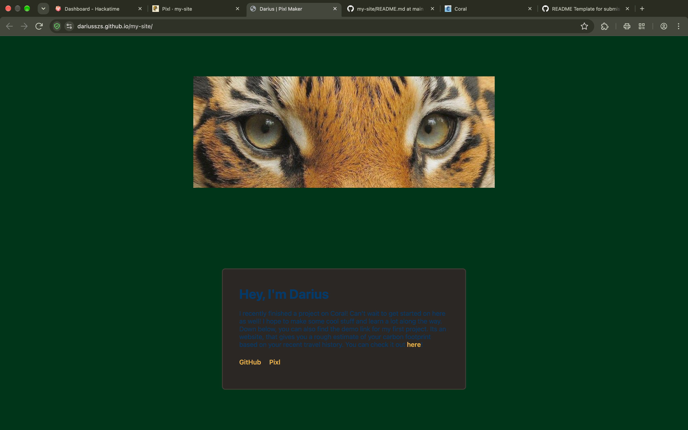

## Darius | my site
I created this site right after my first project on coral.hackclub.com. 
This website is designed, to tell you a bit about me. On it, you can find the links to my project, as well as my Github user. Enjoy!
 ## Features
 Other than it being a short description of me, there is not really a use to it. Other than having fun while programming it of course ! :)
 * **Links** :  <a href="https://dariusszs.github.io/emissions_calculator/" target="_blank">This</a> links leads you to my emission calculator on Github.
 ## Tech Stack
 * **HTML** : For the main page and structure
 * **CSS** : For the main layout, fonts, colors, formats and design in general
 Libraries were not used
 ## Critiria for it to work / dependencies
 - A browser of your choice
 - If you would like to change/modify the code then you'd need a text editor. I for example use VS Code
 ## Installing
1. Download/copy the project to your computer
2. Make sure that all of the files are in one folder. Otherwise it may not work.

## How to run it
1. Open the folder wher ethe project is in
2. Click on index.html. It then should open in your web browser.
3. If you change it in any way,you can see the alterings after pressing F5 or CMD+R on  a Mac. This will refresh the page.
## Troubleshooting
* **Screenshot not showing** Make sure that "screeenshot.png" is in your folder.
* **If your changes do not show** You have to save the file first, and then refresh the page.

## License
MIT License

Copyright (c) 2026 dariusszs

Permission is hereby granted, free of charge, to any person obtaining a copy
of this software and associated documentation files (the "Software"), to deal
in the Software without restriction, including without limitation the rights
to use, copy, modify, merge, publish, distribute, sublicense, and/or sell
copies of the Software, and to permit persons to whom the Software is
furnished to do so, subject to the following conditions:

The above copyright notice and this permission notice shall be included in all
copies or substantial portions of the Software.

THE SOFTWARE IS PROVIDED "AS IS", WITHOUT WARRANTY OF ANY KIND, EXPRESS OR
IMPLIED, INCLUDING BUT NOT LIMITED TO THE WARRANTIES OF MERCHANTABILITY,
FITNESS FOR A PARTICULAR PURPOSE AND NONINFRINGEMENT. IN NO EVENT SHALL THE
AUTHORS OR COPYRIGHT HOLDERS BE LIABLE FOR ANY CLAIM, DAMAGES OR OTHER
LIABILITY, WHETHER IN AN ACTION OF CONTRACT, TORT OR OTHERWISE, ARISING FROM,
OUT OF OR IN CONNECTION WITH THE SOFTWARE OR THE USE OR OTHER DEALINGS IN THE
SOFTWARE.

 [Template](https://gist.github.com/FaizeenHoque/0709576cc598721df07fb62d2430e6fe)

 This was built using a mix of HTML, JavaScript and CSS

